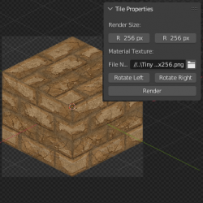
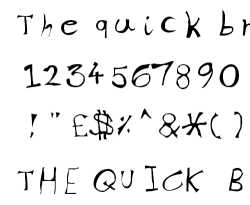
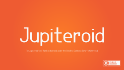
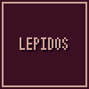
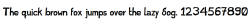
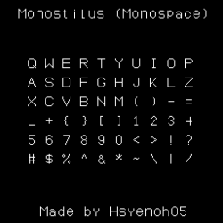
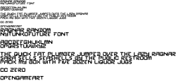
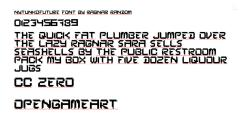
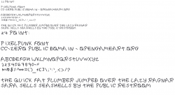
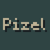

# OpenGameArt: documents

**14 assets from [OpenGameArt](https://opengameart.org), dedicated to the public domain under [CC0](https://creativecommons.org/publicdomain/zero/1.0/).** Use them in any game, free or paid, and change them however you like; no credit is needed.

Documents from OpenGameArt entries licensed CC0 (some also offer other licences; CC0 is the one that applies here). 56.2 MB in all.

This is a copy kept by [zuujis-cc0](https://github.com/zuujis-cc0) so game makers can take single files from GitHub. It is not made by or affiliated with OpenGameArt: the originals, often in more formats and higher resolutions, are on [opengameart.org](https://opengameart.org). If they help you, consider [supporting OpenGameArt](https://opengameart.org/content/faq).

Every file is listed in [MANIFEST.tsv](MANIFEST.tsv) with its size and SHA-256. More free assets: [the Zuujis collection](https://github.com/zuujis-cc0/free-game-assets#readme).

| | | | |
| :-: | :-: | :-: | :-: |
|  <b><a href="character-studio-%E2%80%94-pixel-art-editor">Character Studio — Pixel Art Editor</a></b> by byzmod3d · <a href="https://opengameart.org/content/character-studio-%E2%80%94-pixel-art-editor">source</a> |  <b><a href="free-cheese-font">Free Cheese Font</a></b> by GGBotNet · <a href="https://opengameart.org/content/free-cheese-font">source</a> |  <b><a href="ggbotnet-fonts-cc0-all-in-1">GGBotNet Fonts CC0 (All-in-1)</a></b> by GGBotNet · <a href="https://opengameart.org/content/ggbotnet-fonts-cc0-all-in-1">source</a> |  <b><a href="isometric-tile-toolkit">Isometric Tile Toolkit</a></b> by Screaming Brain Studios · <a href="https://opengameart.org/content/isometric-tile-toolkit">source</a> |
|  <b><a href="jester-scrawl-font">Jester Scrawl Font</a></b> by chilledoutduckgames · <a href="https://opengameart.org/content/jester-scrawl-font">source</a> |  <b><a href="jupiteroid-font">Jupiteroid Font</a></b> by GGBotNet · <a href="https://opengameart.org/content/jupiteroid-font">source</a> |  <b><a href="lepidos-font">Lepidos Font</a></b> by SurrealEmber · <a href="https://opengameart.org/content/lepidos-font">source</a> |  <b><a href="linefont">LineFont</a></b> by Jan125 · <a href="https://opengameart.org/content/linefont">source</a> |
|  <b><a href="monostilus">Monostilus</a></b> by Hsyenoh05 · <a href="https://opengameart.org/content/monostilus">source</a> |  <b><a href="nyntunkofuture-font">NyntunkoFuture Font</a></b> by Ragnar Random · <a href="https://opengameart.org/content/nyntunkofuture-font">source</a> |  <b><a href="nyntunkofuture-font-with-numbers">NyntunkoFuture Font with numbers</a></b> by glitchart · <a href="https://opengameart.org/content/nyntunkofuture-font-with-numbers">source</a> |  <b><a href="pixelpunk-font">PixelPunk Font</a></b> by Ragnar Random · <a href="https://opengameart.org/content/pixelpunk-font">source</a> |
|  <b><a href="pizel-font">Pizel Font</a></b> by SurrealEmber · <a href="https://opengameart.org/content/pizel-font">source</a> |  <b><a href="renascence-mono-font-ttf-and-fnt">Renascence Mono Font (.ttf and .fnt)</a></b> by tomcat · <a href="https://opengameart.org/content/renascence-mono-font-ttf-and-fnt">source</a> |  |  |

---

Kept up to date by this repository's own [update workflow](.github/workflows/update.yml), with code and plan from [cc0-mirror](https://github.com/zuujis-cc0/cc0-mirror). Something wrong? [Open an issue there](https://github.com/zuujis-cc0/cc0-mirror/issues/new) or use the [private report form](https://games.zuujis.com/report).
